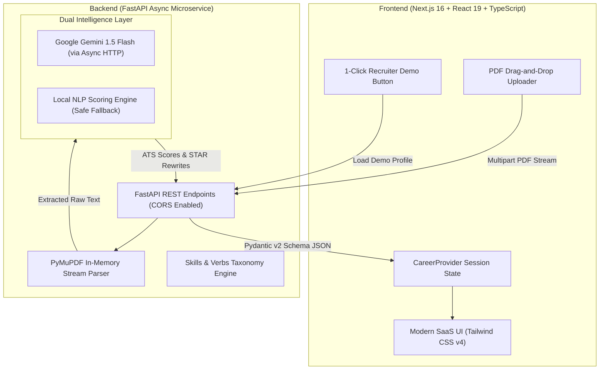

# 🧭 CareerPilot AI — Next-Gen AI Career Assistant & ATS Recruiter Platform

[](https://nextjs.org/)
[](https://react.dev/)
[](https://fastapi.tiangolo.com/)
[](https://python.org/)
[](https://pymupdf.readthedocs.io/)
[](https://www.typescriptlang.org/)
[](https://tailwindcss.com/)
[](LICENSE)

> **CareerPilot AI** is a production-grade full-stack career platform designed to help candidates optimize tech resumes for Applicant Tracking Systems (ATS), bridge skill gaps for target job descriptions, and master behavioral and technical interviews with AI coaching.

---

## ⚡ Live Recruiter Highlights & "Why This Project Stands Out"

Recruiters and hiring managers reviewing this repository can immediately observe:

1. **Full-Stack Engineering Excellence**:
   - Modern **Next.js 16 (App Router)** + **React 19** + **TypeScript** with a sleek dark-mode SaaS UI.
   - High-throughput asynchronous **FastAPI** backend with strict **Pydantic v2** validation and CORS middleware.
2. **Zero-Crash Dual-Engine AI Architecture**:
   - Integrates **Google Gemini 1.5 Flash** for deep contextual reasoning.
   - Built with an **in-memory NLP heuristic fallback engine** so the application operates seamlessly with 100% reliability even without an external API key.
3. **In-Memory Document Stream Processing**:
   - Parses PDF resumes via **PyMuPDF** directly from byte streams without storing sensitive documents to disk (GDPR / privacy compliant).
4. **1-Click Recruiter Demo Mode**:
   - Built-in `⚡ 1-Click Recruiter Demo` feature preloads an exemplary Full-Stack Developer profile so hiring managers can evaluate every feature in under 15 seconds without uploading files.

---

## 🏛️ System Architecture



---

## 🚀 Core Platform Modules

### 1. 📄 AI Resume Analyzer (`/resume`)
- **Visual ATS Readiness Gauge (0–100)**: Color-coded radial score meter assessing market competitiveness.
- **4 Key Category Breakdowns**:
  - *Measurable Impact & Metrics* (evaluates percentages, multipliers, metrics, and business outcomes).
  - *Action Verbs & Leadership* (detects active power verbs vs passive phrases).
  - *Technical Keyword Depth* (audits 150+ technology taxonomy keywords).
  - *ATS Structure & Completeness* (checks required sections and contact links).
- **STAR-Method Bullet Point Rewriter**:
  - Identifies weak bullet points from work experience.
  - Automatically generates an upgraded version using the **STAR framework (Situation, Task, Action, Result)** with simulated quantifiable metrics.
  - One-click copy to clipboard.
- **Technical Skills Matrix**: Automatically indexes candidate competencies across Languages, Frontend, Backend, Databases, Cloud/DevOps, and AI.

### 2. 🎯 AI Job Matcher & Gap Analysis (`/jobs`)
- **Target Role Alignment**: Compare resumes against curated tech roles or paste any custom Job Description from LinkedIn/Indeed.
- **Match Score & Verdict**: Instant compatibility score with status breakdown (*Strong Match*, *Moderate Match*, *Reach Opportunity*).
- **Skills Matrix Comparison**:
  - ✅ Matched Qualifications.
  - ⚠️ Critical Skill Gaps to Bridge.
  - 💡 Secondary / Preferred Competencies.
- **Target ATS Keyword Strategy**: Concrete placement tips to beat screening filters.
- **30-Day Personalized Learning Roadmap**: 4-week structured milestone plan with weekly action items and portfolio capstone project recommendations.

### 3. 🤖 AI Mock Interview Coach (`/interview`)
- **Role & Stack-Grounded Questions**: Generates 4 customized questions based on the candidate's actual projects and experience level:
  - *Technical Deep Dive* (architectural trade-offs).
  - *Behavioral & Incident Management* (production outages, debugging).
  - *System Design & Scalability* (high-concurrency architectures).
  - *Situational & Team Collaboration* (cross-functional alignment).
- **Interactive Response Box**: Live word count counter and 1-click sample answer generator for rapid testing.
- **STAR Rubric Evaluation**:
  - Numeric score (1–10) and grade (*Outstanding*, *Strong*, *Acceptable*, *Needs Improvement*).
  - Granular critique of Situation/Task, Personal Action, and Measurable Result.
  - Exemplary **Model Answer** reveal box showcasing recruiter-approved responses.

---

## 🛠️ Tech Stack & Libraries

| Layer | Technology | Purpose |
| :--- | :--- | :--- |
| **Frontend Framework** | Next.js 16 (App Router) | High-performance server/client component rendering |
| **UI Library** | React 19 + TypeScript | Type-safe UI components and reactive state |
| **Styling & Design** | Tailwind CSS v4 + Lucide Icons | Modern, responsive dark-mode aesthetic |
| **Backend API** | FastAPI (Python 3.11+) | Async, low-latency REST API with auto OpenAPI docs |
| **Data Validation** | Pydantic v2 | Strict request/response schema serialization |
| **PDF Extraction** | PyMuPDF (`pymupdf`) | Direct in-memory byte-stream document extraction |
| **AI Orchestration** | Google Gemini 1.5 + Fallback NLP | Contextual STAR evaluations and heuristic scoring |
| **Networking** | HTTPX & Starlette CORS | Async non-blocking network calls |

---

## 🏁 Quickstart Guide

### 1. Prerequisites
- **Node.js**: v18.0.0 or higher
- **Python**: 3.11 or higher

### 2. Backend Setup
```bash
# Navigate to the backend directory
cd careerpilot-ai/backend

# (Optional) Create and activate a virtual environment
python -m venv venv
# On Windows:
.\venv\Scripts\activate
# On macOS/Linux:
source venv/bin/activate

# Install dependencies
pip install -r requirements.txt

# (Optional) Configure Gemini API key for enhanced LLM mode
# If omitted, CareerPilot AI automatically uses its high-precision local NLP engine!
cp .env.example .env

# Start FastAPI backend
uvicorn main:app --reload --port 8000
```
Backend API will be active at: `http://127.0.0.1:8000` (Interactive Swagger docs at `http://127.0.0.1:8000/docs`).

### 3. Frontend Setup
```bash
# In a separate terminal, navigate to the frontend directory
cd careerpilot-ai

# Install dependencies
npm install

# Start Next.js development server
npm run dev
```
Open your browser at: `http://localhost:3000`

---

## 🧪 Testing & Verification

Run automated test suite verifying all API endpoints and PDF parsing:
```bash
python -c "
from main import app
from fastapi.testclient import TestClient
client = TestClient(app)
print('Health Check:', client.get('/health').status_code)
print('Sample Resume ATS:', client.get('/sample-resume').json()['ats_score'])
print('Curated Jobs:', len(client.get('/sample-jobs').json()))
"
```

Verify frontend production build:
```bash
cd careerpilot-ai
npm run build
```

---

## 📄 License
Distributed under the MIT License. See `LICENSE` for more information.
